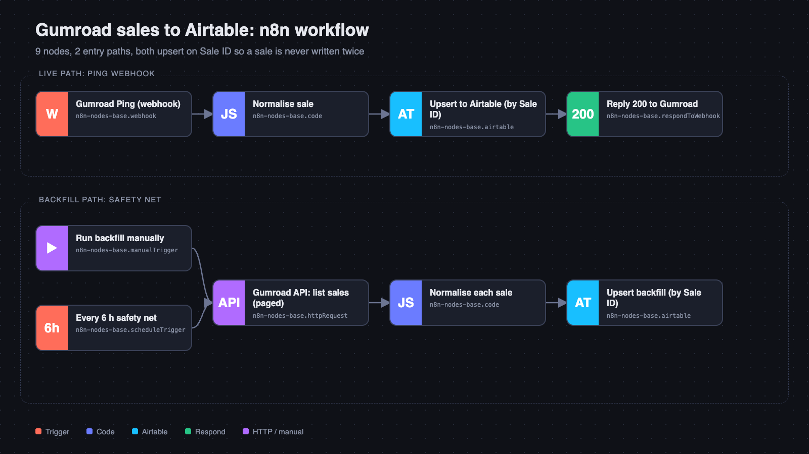
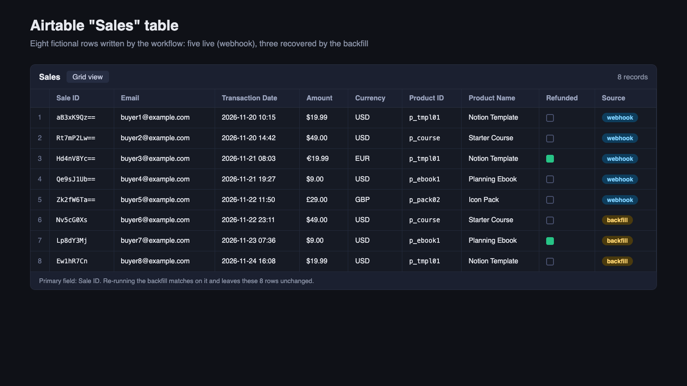
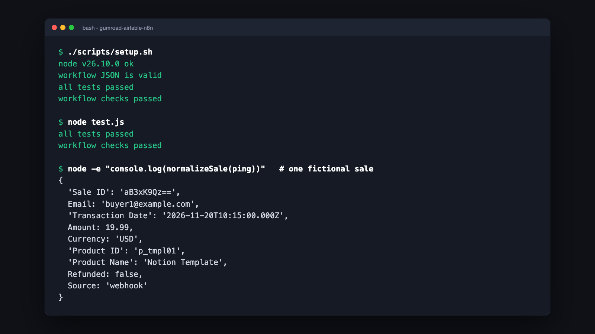
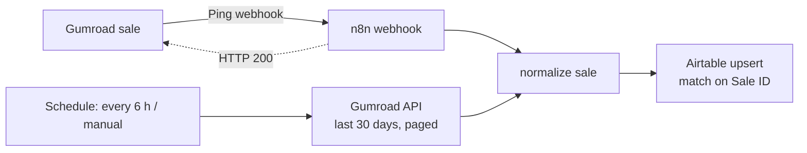

# Gumroad sales → Airtable (n8n)

**Every Gumroad sale lands in Airtable within seconds, and a scheduled backfill catches anything that was missed. A sale is never written twice.**

[](https://github.com/Zeusmma/gumroad-airtable-n8n/actions/workflows/test.yml)
[](LICENSE)




## Contents

- [At a glance](#at-a-glance)
- [Quick start](#quick-start)
- [Set up with an AI assistant](#set-up-with-an-ai-assistant)
- [Screenshots](#screenshots)
- [Architecture](#architecture)
- [Configuration](#configuration)
- [Airtable table "Sales"](#airtable-table-sales)
- [Verification](#verification)
- [Project structure](#project-structure)
- [FAQ](#faq)
- [Limitations](#limitations)
- [Contributing](#contributing)
- [License](#license)

## At a glance

| | |
|---|---|
| Lines of code | JSON 286 · JavaScript 40 · Shell 29 · YAML 12 (total 367) |
| Checks | 14 assertions in `node test.js` (data cleaning plus workflow integrity), run in CI |
| Platforms | Any OS with Node.js 18+ for the tests; the workflow runs on n8n Cloud or self-hosted n8n |
| Dependencies | 0 runtime packages (Node.js standard library only) |
| Entry paths | Gumroad Ping webhook, 6-hourly schedule, manual run |
| Idempotency | Airtable upsert matched on `Sale ID` |

## Quick start

```sh
git clone https://github.com/Zeusmma/gumroad-airtable-n8n.git && cd gumroad-airtable-n8n
./scripts/setup.sh          # checks Node.js, validates the workflow JSON, runs the tests
# then import gumroad-to-airtable.n8n.json into n8n and follow AI_SETUP.md steps 3-9
```

Full manual steps (about 15 minutes):

1. Import `gumroad-to-airtable.n8n.json` into n8n.
2. Add an Airtable personal access token as the credential, and set the n8n variables `AIRTABLE_BASE_ID` and `GUMROAD_ACCESS_TOKEN`.
3. Activate the workflow and copy the production webhook URL.
4. In Gumroad: Settings → Advanced → Ping → paste the URL.
5. Make a test purchase (or a $0 test product) and check that the row appears. Then run the backfill once.

## Set up with an AI assistant

[`AI_SETUP.md`](AI_SETUP.md) contains a copy-paste prompt and a numbered checklist for Claude Code, Cursor or any other AI coding assistant. It covers prerequisites, the Airtable table, credentials, activation, verification with expected results, troubleshooting and cleanup. The assistant is told to ask you for every credential and never to invent one.

## Screenshots

| Airtable "Sales" table (fictional data) | Test output |
|---|---|
|  |  |

## Architecture




1. **Live:** each new sale reaches n8n, which cleans the data and upserts one row into Airtable, then answers Gumroad with 200 so Gumroad does not retry.
2. **Backfill:** a manual run (and an automatic run every 6 hours) reads the last 30 days of sales from the Gumroad API page by page and upserts them the same way.
3. **No duplicates:** both paths upsert on `Sale ID`, so running the backfill again changes nothing.

## Configuration

No secrets are stored in the workflow file.

| Setting | Where | Purpose |
|---|---|---|
| `AIRTABLE_BASE_ID` | n8n variable | Base that holds the `Sales` table |
| `GUMROAD_ACCESS_TOKEN` | n8n variable | Used by the backfill to call `api.gumroad.com/v2/sales` |
| Airtable personal access token | n8n credential | Scopes: `data.records:read`, `data.records:write`, `schema.bases:read` |

## Airtable table "Sales"

| Field | Type |
|---|---|
| Sale ID | Single line text (primary) |
| Email | Email |
| Transaction Date | Date with time |
| Amount | Currency |
| Currency | Single line text |
| Product ID | Single line text |
| Product Name | Single line text |
| Refunded | Checkbox |
| Source | Single select: webhook / backfill |

## Verification

- A test sale appears in Airtable with the right email, amount and date.
- The same test sale sent twice still gives one row.
- The backfill run reports the same count of sales as the Gumroad dashboard for the period.

The data-cleaning logic and the workflow file are covered by `node test.js` (no dependencies; CI uses Node 20). The tests also check that both Code nodes in the workflow embed exactly the function in `normalize.js`.

## Project structure

| File | Role |
|---|---|
| `gumroad-to-airtable.n8n.json` | The n8n workflow (import this) |
| `normalize.js` | Turns a webhook body or API item into one Airtable row |
| `test.js` | Unit tests for `normalize.js` and workflow integrity checks |
| `scripts/setup.sh` | One-command prerequisite check, JSON validation and test run |
| `AI_SETUP.md` | Prompt and checklist for AI-assisted setup |
| `docs/images/` | Workflow diagram, sample Airtable table, test output |
| `.github/workflows/test.yml` | CI: runs `node test.js` and a shell syntax check |

## FAQ

**Does it work with Zapier or Make?** No, this is an n8n workflow. The `normalize.js` function can be reused anywhere JavaScript runs.

**What happens if Gumroad sends the same ping twice?** The upsert matches on `Sale ID`, so the row is updated, not duplicated.

**Can I change the backfill window?** Yes. Edit the `after` query parameter in the node "Gumroad API: list sales (paged)".

**Do I need the n8n Variables feature?** The workflow reads two variables. If your plan does not include variables, replace the two expressions with literal values.

## Limitations

- Backfill window is fixed at 30 days; widen it in the workflow if you need a longer history.
- Refund updates are picked up by the next backfill, not instantly.
- Only sales are synced (no subscribers or payouts).

## Contributing

Issues and pull requests are welcome, see [CONTRIBUTING.md](CONTRIBUTING.md). Report security problems as described in [SECURITY.md](SECURITY.md). Release notes are in [CHANGELOG.md](CHANGELOG.md).

## License

MIT, see [LICENSE](LICENSE).
